# 🚲 Bikes — Automação, Observabilidade e Esteira DevSecOps

[](https://github.com/wlli173/bikes/actions/workflows/ci-cd.yml)

API REST de uma locadora de bicicletas (usuários, clientes, bicicletas, locações, devoluções e relatórios em PDF) em **Spring Boot 4.1.1 / Java 25** (baseada no projeto da disciplina [fabiojrp/bikes-2026.2](https://github.com/fabiojrp/bikes-2026.2)), conteinerizada com **Dockerfile Multistage**, publicada por uma **esteira CI/CD no GitHub Actions** e acompanhada por uma stack local completa de **métricas (Prometheus + Grafana)** e **logs centralizados (Graylog + OpenSearch + MongoDB)** — tudo sobe com um único comando.

```bash
docker compose up --build
```

---

## Sumário

1. [Arquitetura](#-arquitetura)
2. [Como executar](#-como-executar)
3. [API da aplicação](#-api-da-aplicação)
   - [Perfis, autenticação e códigos de resposta](#perfis-autenticação-e-códigos-de-resposta)
   - [Catálogo de endpoints](#catálogo-de-endpoints)
   - [Passo a passo dos fluxos pelo Swagger](#passo-a-passo-dos-fluxos-pelo-swagger)
   - [Relatórios em PDF (JasperReports)](#relatórios-em-pdf-jasperreports)
4. [Dockerfile Multistage](#-dockerfile-multistage-requisito-eliminatório)
5. [Pipeline CI/CD](#-pipeline-cicd-github-actions)
6. [Monitoramento — Prometheus](#-monitoramento--prometheus)
7. [Observabilidade — Grafana](#-observabilidade--grafana)
8. [Logs centralizados — Graylog](#-logs-centralizados--graylog)
9. [Decisões técnicas](#-decisões-técnicas)
10. [Testes automatizados](#-testes-automatizados)
11. [Estrutura do repositório](#-estrutura-do-repositório)
12. [Mapeamento da rubrica](#-mapeamento-da-rubrica)
13. [Troubleshooting](#-troubleshooting)

---

## 🏗️ Arquitetura

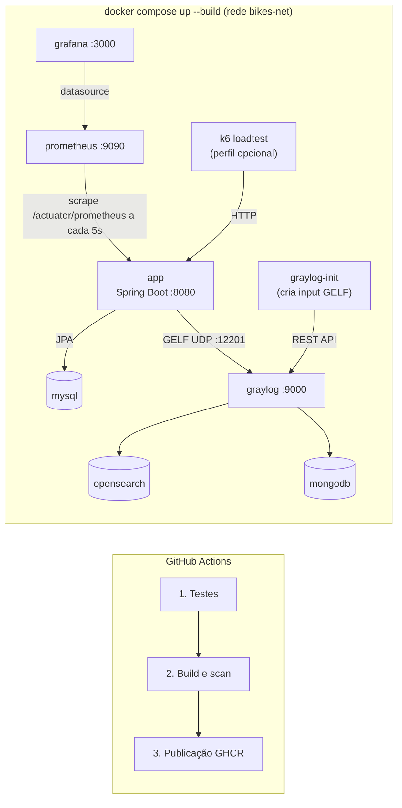

| Serviço | URL | Credenciais |
|---------|-----|-------------|
| **API Bikes** | http://localhost:8080/api/v1/usuarios | — |
| **Swagger UI** | http://localhost:8080/docs-bikes.html | — |
| **Actuator** | http://localhost:8080/actuator/health · `/actuator/prometheus` | — |
| **Prometheus** | http://localhost:9090/targets | — |
| **Grafana** | http://localhost:3000 → dashboard *Bikes — JVM & Spring Boot* | `admin` / `admin` (ou anônimo como Viewer) |
| **Graylog** | http://localhost:9000 | `admin` / `admin` |
| MySQL, MongoDB, OpenSearch | apenas rede interna | — |

Ordem de subida garantida por `depends_on` + `condition` e healthchecks reais:

```
mongodb ─┐
         ├─(healthy)─► graylog ─(healthy)─► graylog-init ─(completed)─┐
opensearch┘                                                          ├─► app ─► (loadtest)
mysql ─────────────────────────(healthy)─────────────────────────────┘
prometheus ─(healthy)─► grafana
```

---

## 🚀 Como executar

### Pré-requisitos

| Requisito | Mínimo |
|-----------|--------|
| Docker + Docker Compose V2 | Docker 24+ |
| Memória para o Docker | **6 GB** (recomendado 8 GB) |
| `vm.max_map_count` (Linux/WSL2) | 262144 — ver [Troubleshooting](#-troubleshooting) |

### 1. Subir a stack (comando único)

```bash
docker compose up --build
```

Nenhuma etapa manual é necessária: o input GELF do Graylog, o datasource e o dashboard do Grafana são provisionados automaticamente. A primeira execução baixa ~2,5 GB de imagens; com as imagens em cache, a stack inteira fica `healthy` em **~70 s**.

Para acompanhar em outro terminal:

```bash
docker compose ps
```

```
NAME               IMAGE                                 STATUS
bikes-app          bikes-app                             Up (healthy)
bikes-grafana      grafana/grafana:11.6.0                Up (healthy)
bikes-graylog      graylog/graylog:6.1.16                Up (healthy)
bikes-mongodb      mongo:6.0.20                          Up (healthy)
bikes-mysql        mysql:8.0.39                          Up (healthy)
bikes-opensearch   opensearchproject/opensearch:2.15.0   Up (healthy)
bikes-prometheus   prom/prometheus:v3.4.1                Up (healthy)
```

> `bikes-graylog-init` aparece como `Exited (0)` — é esperado: ele só cria o input GELF e termina.

### 2. Gerar tráfego (popular dashboards e logs)

```bash
docker compose --profile loadtest up loadtest
```

O script k6 ([loadtest/script.js](loadtest/script.js)) roda por 2 minutos (até 10 usuários virtuais) e exercita todos os cenários: `201`, `200`, `422` (validação), `404` e `500`, além de logs DEBUG/INFO/WARN/ERROR.

### 3. Parar e limpar

```bash
docker compose --profile loadtest down -v --remove-orphans
```

---

## 📘 API da aplicação

Com a stack no ar (`docker compose up --build`), a aplicação responde em **http://localhost:8080**. Todos os recursos de negócio ficam sob `/api/v1` e a documentação interativa (SpringDoc/OpenAPI) em **http://localhost:8080/docs-bikes.html**.

### Perfis, autenticação e códigos de resposta

| Perfil | Como se obtém | O que pode fazer |
|--------|---------------|------------------|
| **Público** | nenhum token | Criar usuário, autenticar, Swagger, Actuator e endpoints de demonstração |
| **`CLIENTE`** | todo usuário criado por `POST /api/v1/usuarios` nasce com este perfil | Cadastrar-se como cliente, consultar os próprios dados, solicitar locações e devolver as próprias bicicletas |
| **`ADMIN`** | promovido no banco (ver [passo 0](#passo-0--preparar-um-usuário-admin)) | Gerir bicicletas, consultar qualquer usuário/cliente/locação e gerar os relatórios |

- Autenticação por **JWT**: `POST /api/v1/auth` devolve `{"token":"eyJ..."}`, válido por **20 minutos**. As demais rotas exigem o cabeçalho `Authorization: Bearer <token>`.
- Respostas de erro seguem um único formato (`ErrorMessage`), e erros de validação trazem o mapa `errors` por campo:

```json
{"errors":{"password":"tamanho deve ser entre 6 e 6","username":"O email deve ser válido"},
 "message":"Campo(s) inválido(s)","method":"POST","path":"/api/v1/usuarios",
 "status":422,"statusMessage":"Unprocessable Content"}
```

| Código | Significado na API |
|--------|--------------------|
| `200` / `201` | Sucesso / recurso criado |
| `400` | Credenciais inválidas no `POST /api/v1/auth` |
| `403` | Sem token, token inválido/expirado ou perfil sem permissão para a operação |
| `404` | Recurso não encontrado (usuário, cliente, bicicleta, locação; nenhuma bicicleta disponível) |
| `409` | Conflito de regra de negócio (e-mail/CPF/código duplicado, bicicleta indisponível, locação já finalizada) |
| `422` | Corpo da requisição inválido (Bean Validation) — campo a campo em `errors` |
| `500` | Falha ao gerar um relatório PDF (`RelatorioException`) |

### Catálogo de endpoints

#### Autenticação e usuários (`Autenticacao`, `Usuarios`)

| Método | Rota | Perfil | Descrição | Corpo | Respostas |
|--------|------|--------|-----------|-------|-----------|
| `POST` | `/api/v1/usuarios` | público | Cria usuário com perfil `CLIENTE` | `{"username":"ana@bikes.com","password":"123456"}` (e-mail válido; senha com exatamente 6 caracteres) | `201`, `409`, `422` |
| `POST` | `/api/v1/auth` | público | Autentica e devolve o JWT | `{"username":"ana@bikes.com","password":"123456"}` | `200`, `400`, `422` |
| `GET` | `/api/v1/usuarios` | `ADMIN` | Lista todos os usuários (`id`, `username`, `role`) | — | `200`, `403` |
| `GET` | `/api/v1/usuarios/{id}` | `ADMIN` ou o próprio `CLIENTE` | Busca usuário por id | — | `200`, `403`, `404` |
| `PATCH` | `/api/v1/usuarios/{id}` | o próprio usuário | Troca a senha (BCrypt) | `{"senhaAtual":"123456","novaSenha":"654321","confirmaSenha":"654321"}` | `200`, `400`, `403`, `404`, `422` |

#### Clientes (`Clientes`) — requisito 4

| Método | Rota | Perfil | Descrição | Corpo | Respostas |
|--------|------|--------|-----------|-------|-----------|
| `POST` | `/api/v1/clientes` | `CLIENTE` | Cadastra o cliente vinculado ao usuário autenticado (um por usuário) | `{"nome":"Ana Silva","cpf":"12345678901"}` (CPF com 11 dígitos, único) | `201`, `403`, `409`, `422` |
| `GET` | `/api/v1/clientes/detalhes` | `CLIENTE` | Devolve os dados do cliente autenticado | — | `200`, `403`, `404` |
| `GET` | `/api/v1/clientes/{id}` | `ADMIN` ou o próprio `CLIENTE` | Busca cliente por id | — | `200`, `403`, `404` |
| `GET` | `/api/v1/clientes` | `ADMIN` | Lista todos os clientes | — | `200`, `403` |
| `GET` | `/api/v1/clientes/relatorio` | `ADMIN` | Relatório de clientes em **PDF** (JasperReports) | — | `200`, `403`, `500` |

#### Bicicletas (`Bicicletas`) — requisito 5

| Método | Rota | Perfil | Descrição | Corpo | Respostas |
|--------|------|--------|-----------|-------|-----------|
| `POST` | `/api/v1/bicicletas` | `ADMIN` | Cadastra bicicleta (`codigo` único) | `{"codigo":"BK01","modelo":"Caloi Elite Carbon","status":"DISPONIVEL"}` — status `DISPONIVEL`, `ALUGADA` ou `MANUTENCAO` | `201`, `403`, `409`, `422` |
| `GET` | `/api/v1/bicicletas/{codigo}` | `ADMIN` | Localiza a bicicleta pelo código | — | `200`, `403`, `404` |
| `GET` | `/api/v1/bicicletas` | `ADMIN` | Lista todas as bicicletas | — | `200`, `403` |
| `PATCH` | `/api/v1/bicicletas/{codigo}/status` | `ADMIN` | Envia para `MANUTENCAO` ou libera (`DISPONIVEL`). Bicicleta `ALUGADA` só é liberada pela devolução (`409`) | `{"status":"MANUTENCAO"}` | `200`, `403`, `404`, `409`, `422` |

#### Locações, devoluções e relatório (`Locacoes`) — requisitos 6, 7 e 8

| Método | Rota | Perfil | Descrição | Corpo | Respostas |
|--------|------|--------|-----------|-------|-----------|
| `POST` | `/api/v1/locacoes` | `CLIENTE` | Solicita a locação. `codigoBicicleta` é opcional: sem ele o sistema escolhe a primeira `DISPONIVEL`. Só os 4 últimos dígitos do cartão são persistidos; a bicicleta passa a `ALUGADA` | `{"codigoBicicleta":"BK01","dataPrevistaDevolucao":"2027-01-10T18:00:00","cartao":{"numero":"4111111111111111","titular":"ANA SILVA","validade":"12/30","cvv":"123"}}` | `201`, `403`, `404`, `409`, `422` |
| `PATCH` | `/api/v1/locacoes/{id}/devolucao` | `ADMIN` ou dono da locação | Registra a devolução: data/hora efetiva, valor (**R$ 5,00 por hora iniciada**, mínimo 1 h), status `FINALIZADA` e bicicleta `DISPONIVEL`. Com `problema=true` a bicicleta vai para `MANUTENCAO` | `{"problema":true,"descricaoProblema":"Pneu traseiro furado"}` | `200`, `403`, `404`, `409`, `422` |
| `GET` | `/api/v1/locacoes/{id}` | `ADMIN` ou dono da locação | Busca locação por id | — | `200`, `403`, `404` |
| `GET` | `/api/v1/locacoes` | `ADMIN` | Lista todas as locações | — | `200`, `403` |
| `GET` | `/api/v1/locacoes/relatorio` | `ADMIN` | Relatório **JSON**: cliente, bicicleta, retirada, devolução, duração, valor e status (mais recentes primeiro) | — | `200`, `403` |
| `GET` | `/api/v1/locacoes/relatorio/pdf` | `ADMIN` | O mesmo relatório em **PDF** (JasperReports) com totais de locações, tempo de uso e valor faturado | — | `200`, `403`, `500` |

#### Demonstração, documentação e operação (fora do Swagger)

| Método | Rota | Perfil | Descrição |
|--------|------|--------|-----------|
| `GET` | `/api/v1/demo/log` | público | Emite logs `DEBUG`/`INFO`/`WARN`/`ERROR` (evidência para o Graylog) |
| `GET` | `/api/v1/demo/log/error` | público | Simula uma falha `500` com stack trace no log |
| `GET` | `/docs-bikes.html` | público | Swagger UI |
| `GET` | `/docs-bikes` | público | Documento OpenAPI (JSON) consumido pelo Swagger UI |
| `GET` | `/actuator/health` | público | Healthcheck usado pelo `docker compose` (`{"status":"UP"}`) |
| `GET` | `/actuator/info` | público | Informações da aplicação |
| `GET` | `/actuator/prometheus` | público | Métricas no formato Prometheus (scrape a cada 5 s) |

Exemplos de resposta:

```json
// POST /api/v1/locacoes → 201
{"id":1,"clienteId":1,"nomeCliente":"Ana Silva","codigoBicicleta":"BK01",
 "dataRetirada":"2026-11-23T22:33:10","dataPrevistaDevolucao":"2027-01-10T18:00:00",
 "dataDevolucao":null,"cartaoFinal":"1111","valor":null,"status":"ATIVA","observacao":null}

// PATCH /api/v1/locacoes/1/devolucao → 200
{"id":1,"clienteId":1,"nomeCliente":"Ana Silva","codigoBicicleta":"BK01",
 "dataRetirada":"2026-11-23T22:33:10","dataPrevistaDevolucao":"2027-01-10T18:00:00",
 "dataDevolucao":"2026-11-23T23:05:42","cartaoFinal":"1111","valor":5.00,"status":"FINALIZADA",
 "observacao":"Pneu traseiro furado"}

// GET /api/v1/locacoes/relatorio → 200
[{"id":1,"nomeCliente":"Ana Silva","codigoBicicleta":"BK01","dataRetirada":"2026-11-23T22:33:10",
  "dataDevolucao":"2026-11-23T23:05:42","duracaoMinutos":32,"duracao":"0h 32min","valor":5.00,"status":"FINALIZADA"}]

// POST /api/v1/locacoes com a bicicleta já alugada → 409
{"message":"Bicicleta com código 'BK01' não está disponível (status ALUGADA)",
 "method":"POST","path":"/api/v1/locacoes","status":409,"statusMessage":"Conflict"}
```

### Passo a passo dos fluxos pelo Swagger

Abra **http://localhost:8080/docs-bikes.html**. A página lista as operações agrupadas por tag (`Autenticacao`, `Usuarios`, `Clientes`, `Bicicletas`, `Locacoes`). Operações com cadeado exigem token; as sem cadeado (`POST /usuarios` e `POST /auth`) são públicas. Em cada operação, o fluxo é sempre **Try it out → preencher parâmetros/corpo → Execute** e conferir o *Server response*.

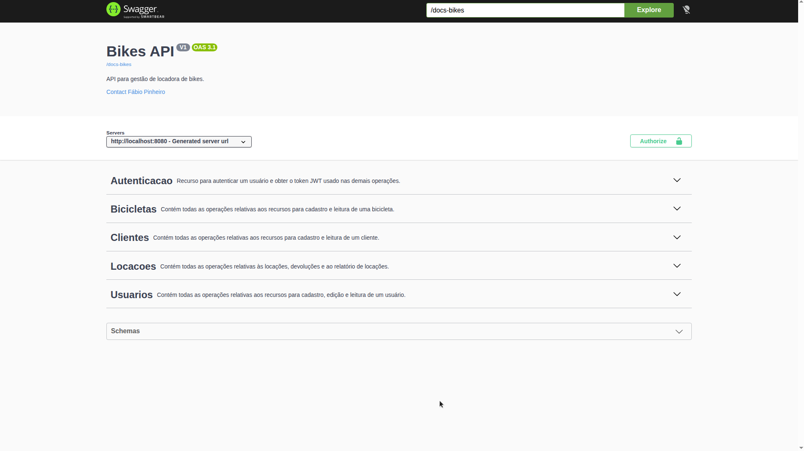

#### Passo 0 — Preparar um usuário ADMIN

Todo usuário criado pela API nasce como `CLIENTE`. Para os fluxos de administração, crie um usuário e promova-o no banco (uma única vez; o volume `mysql-data` preserva o dado):

1. Em **Usuarios → `POST /api/v1/usuarios`** crie o administrador:

```json
{"username":"admin@bikes.com","password":"123456"}
```

2. Promova-o no MySQL do compose (a senha do `root` é a `MYSQL_ROOT_PASSWORD` do seu `.env`):

```bash
docker compose exec mysql mysql -uroot -p bikes \
  -e "UPDATE usuarios SET role='ROLE_ADMIN' WHERE username='admin@bikes.com';"
```

> O perfil é lido do banco a cada requisição, então um token já emitido para esse usuário passa a valer como `ADMIN` imediatamente — não é preciso autenticar de novo.

#### Passo 1 — Criar o usuário cliente

**Usuarios → `POST /api/v1/usuarios`** → Try it out → corpo abaixo → Execute → `201` com `{"id":2,"username":"ana@bikes.com","role":"CLIENTE"}`.

```json
{"username":"ana@bikes.com","password":"123456"}
```

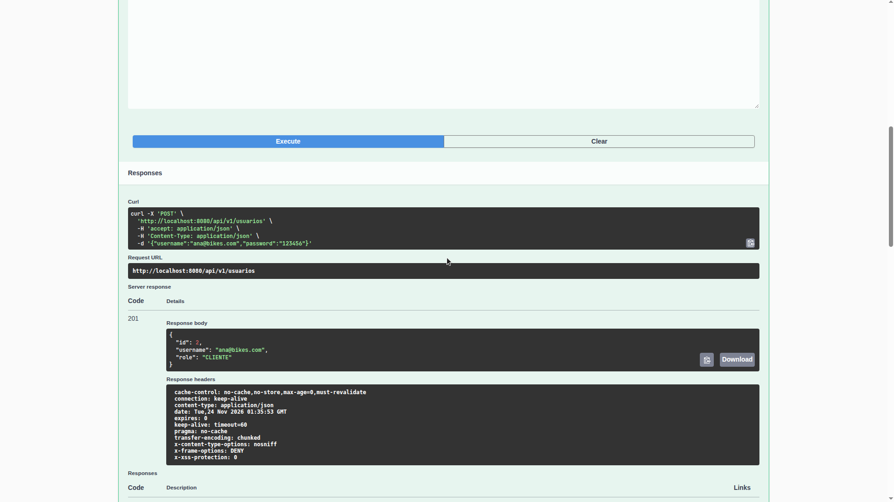

#### Passo 2 — Autenticar e autorizar o Swagger

1. **Autenticacao → `POST /api/v1/auth`** → Try it out → corpo com e-mail e senha → Execute → `200` com `{"token":"eyJ..."}`. Copie **apenas o valor** do token (sem aspas e sem o prefixo `Bearer`).

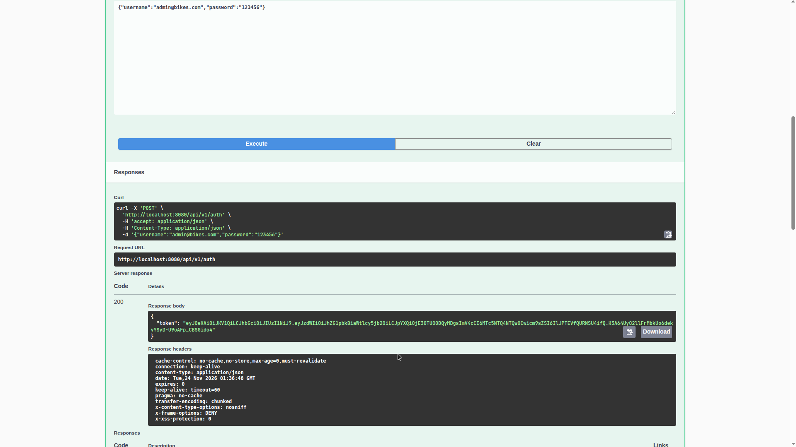

2. Clique no botão verde **Authorize** (canto superior direito), cole o token no campo *Value*, clique em **Authorize** e depois em **Close**. A partir daí o Swagger envia `Authorization: Bearer <token>` em todas as operações com cadeado.

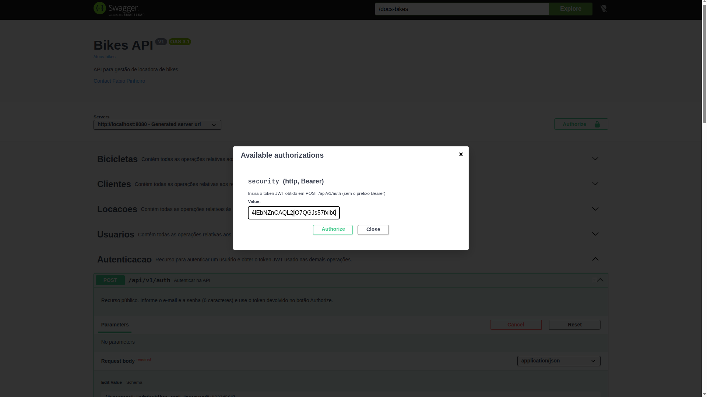

> **Trocar de usuário** (cliente ⇄ admin): **Authorize → Logout**, autentique o outro usuário em `POST /auth`, cole o novo token e **Authorize** novamente. O token expira em **20 minutos**; ao receber `403` em uma operação que antes funcionava, repita este passo.

#### Fluxo A — Administrador: cadastrar e gerir bicicletas (requisito 5)

Autorizado com o token do **admin**:

1. **Bicicletas → `POST /api/v1/bicicletas`** → `201` para cada bicicleta:

```json
{"codigo":"BK01","modelo":"Caloi Elite Carbon","status":"DISPONIVEL"}
```
```json
{"codigo":"BK02","modelo":"Sense Impact Pro","status":"DISPONIVEL"}
```

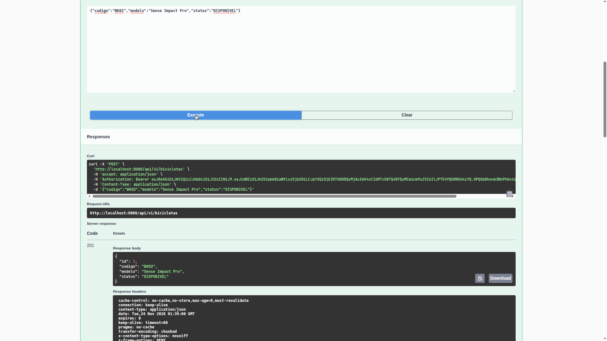

2. **Bicicletas → `GET /api/v1/bicicletas`** → lista com as duas bicicletas. **`GET /api/v1/bicicletas/{codigo}`** com `BK01` → `200`; com um código inexistente → `404`.
3. **Bicicletas → `PATCH /api/v1/bicicletas/{codigo}/status`** com `codigo = BK02` e corpo `{"status":"MANUTENCAO"}` → `200` com `status: MANUTENCAO`. Repita com `{"status":"DISPONIVEL"}` para liberá-la.
4. Repetir o cadastro de `BK01` → `409` (código duplicado); omitir o `modelo` → `422` com o campo em `errors`.

#### Fluxo B — Cliente: cadastro e consulta dos próprios dados (requisito 4)

Troque para o token da **cliente** (`ana@bikes.com`):

1. **Clientes → `POST /api/v1/clientes`** → `201` com `{"id":1,"nome":"Ana Silva","cpf":"12345678901"}`:

```json
{"nome":"Ana Silva","cpf":"12345678901"}
```

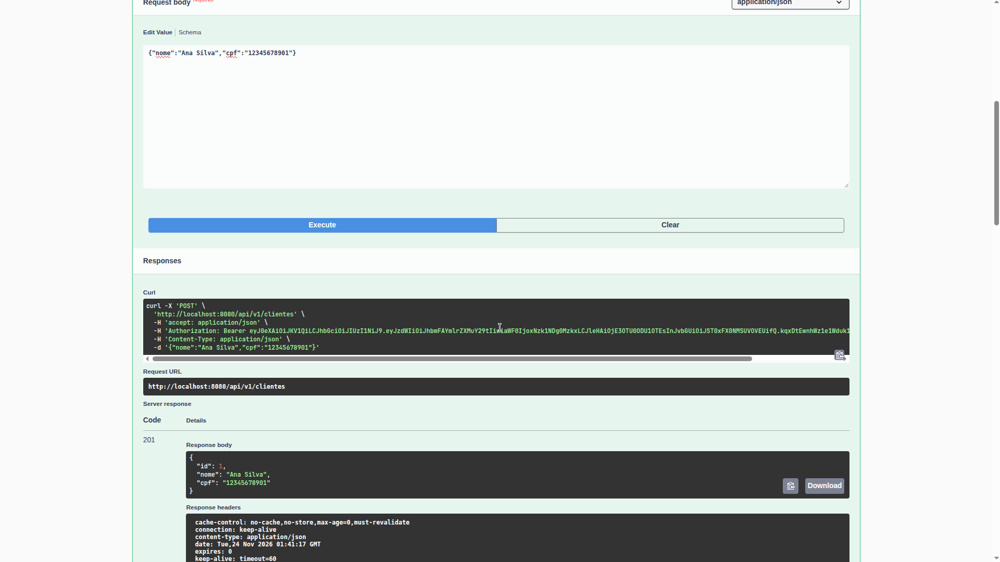

2. **Clientes → `GET /api/v1/clientes/detalhes`** → `200` com os dados do cliente autenticado.
3. Um segundo `POST /api/v1/clientes` com o mesmo usuário → `409` ("Usuário já possui um cliente cadastrado"); um CPF de outro cliente → `409`.
4. Com o token do **admin**, `POST /api/v1/clientes` → `403` (apenas o perfil cliente se cadastra), enquanto **`GET /api/v1/clientes`** e **`GET /api/v1/clientes/{id}`** → `200`.

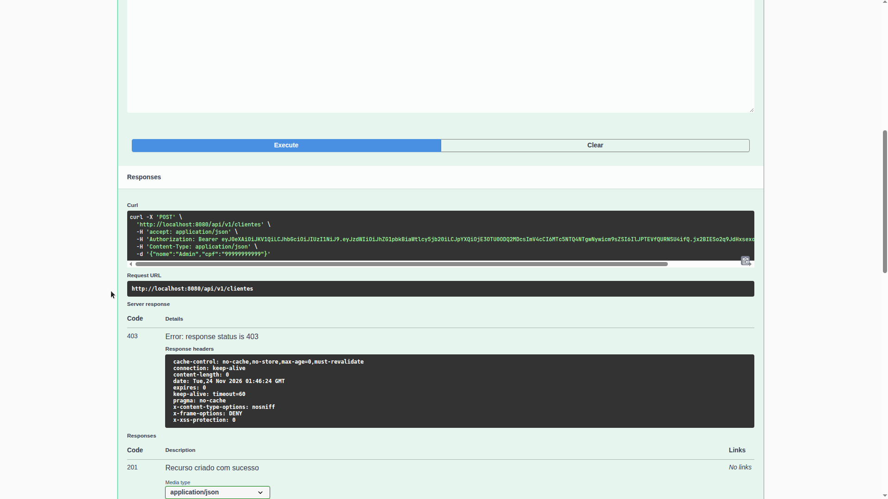

#### Fluxo C — Cliente: solicitar a locação (requisito 6)

Ainda com o token da **cliente**:

1. **Locacoes → `POST /api/v1/locacoes`** → `201` com `status: ATIVA`, `cartaoFinal: "1111"` e `valor: null`. A `dataPrevistaDevolucao` precisa ser futura (`yyyy-MM-ddTHH:mm:ss`):

```json
{
  "codigoBicicleta": "BK01",
  "dataPrevistaDevolucao": "2027-01-10T18:00:00",
  "cartao": {"numero": "4111111111111111", "titular": "ANA SILVA", "validade": "12/30", "cvv": "123"}
}
```

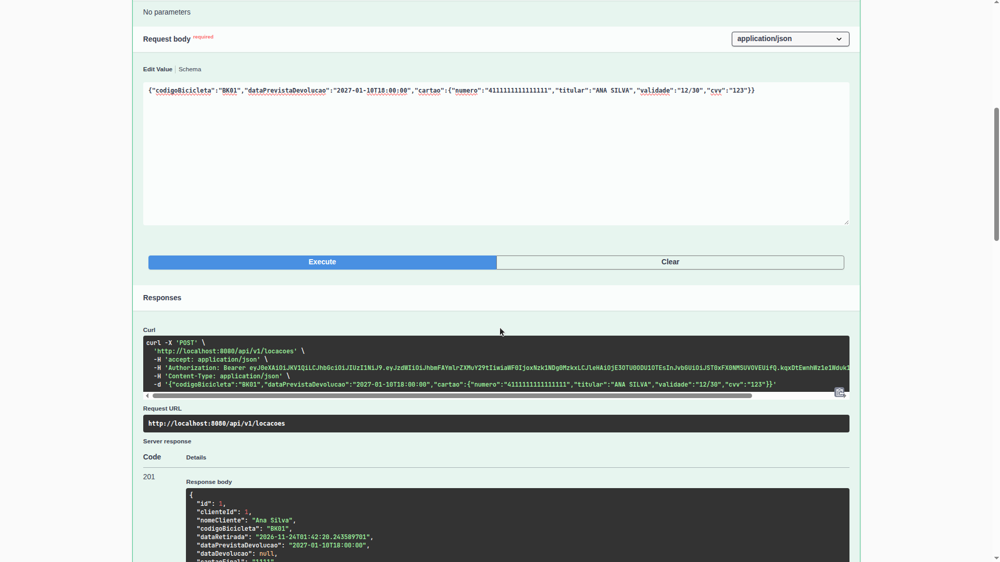

2. **Locacoes → `GET /api/v1/locacoes/{id}`** com `id = 1` → `200` (a cliente só enxerga as próprias locações; outro id → `403`).
3. Repetir o `POST` para `BK01` → `409` ("Bicicleta com código 'BK01' não está disponível (status ALUGADA)").
4. `POST` **sem** `codigoBicicleta` → o sistema escolhe a primeira bicicleta `DISPONIVEL`; se todas estiverem alugadas ou em manutenção → `404` ("Nenhuma bicicleta disponível para locação").
5. Com o token do **admin**, **Bicicletas → `GET /api/v1/bicicletas/BK01`** mostra `status: ALUGADA`, e **`PATCH .../BK01/status`** → `409` (só a devolução libera uma bicicleta alugada).

#### Fluxo D — Devolução (requisito 7)

Com o token da **cliente** (dona da locação) ou do **admin**:

1. **Locacoes → `PATCH /api/v1/locacoes/{id}/devolucao`** com `id = 1`:

```json
{"problema": true, "descricaoProblema": "Pneu traseiro furado"}
```

Resposta `200` com `status: FINALIZADA`, `dataDevolucao` preenchida, `valor` calculado (R$ 5,00 por hora iniciada; uma devolução minutos depois custa `5.00`) e `observacao` com o problema. Como `problema = true`, a bicicleta `BK01` vai para `MANUTENCAO`; com `{"problema": false}` ela volta a `DISPONIVEL`.

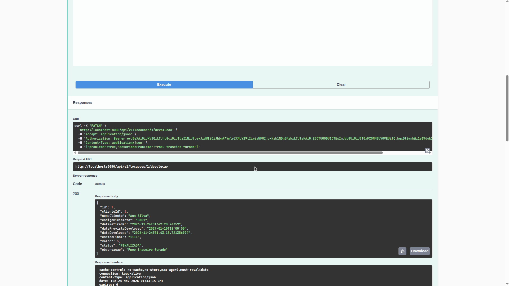

2. Repetir a devolução → `409` ("Locação com id=1 já foi finalizada").
3. Com o token do **admin**, **`PATCH /api/v1/bicicletas/BK01/status`** com `{"status":"DISPONIVEL"}` recoloca a bicicleta em operação após o reparo.

#### Fluxo E — Administrador: relatórios de locações e devoluções (requisito 8)

Troque para o token do **admin**:

1. **Locacoes → `GET /api/v1/locacoes`** → todas as locações, com cliente, bicicleta, datas, cartão (4 dígitos), valor e status.
2. **Locacoes → `GET /api/v1/locacoes/relatorio`** → `200` com a relação em JSON (cliente, bicicleta, retirada, devolução, `duracao`, `valor`, `status`).

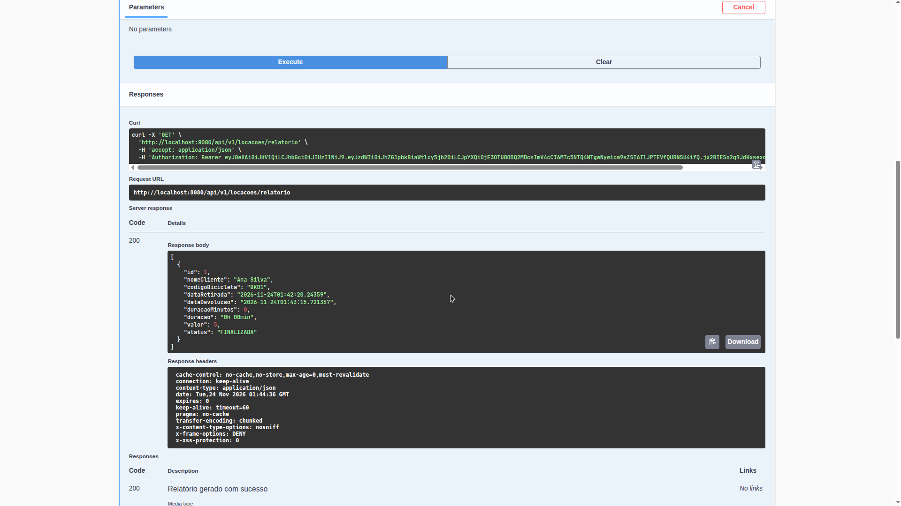

3. **Locacoes → `GET /api/v1/locacoes/relatorio/pdf`** → `200` com `content-type: application/pdf` e `content-disposition: inline; filename=locacoes-<timestamp>.pdf` nos *Response headers*. Como o corpo é binário, o Swagger mostra o conteúdo bruto (`%PDF-1.5 ...`) e o botão **Download** para salvar o arquivo. O mesmo vale para **Clientes → `GET /api/v1/clientes/relatorio`**.

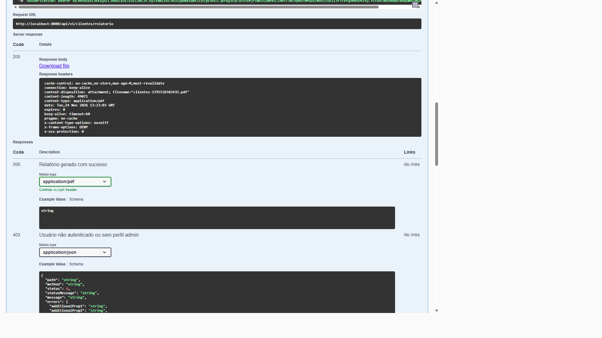

4. Com o token da **cliente**, qualquer um desses três endpoints → `403`.

#### Resumo dos fluxos

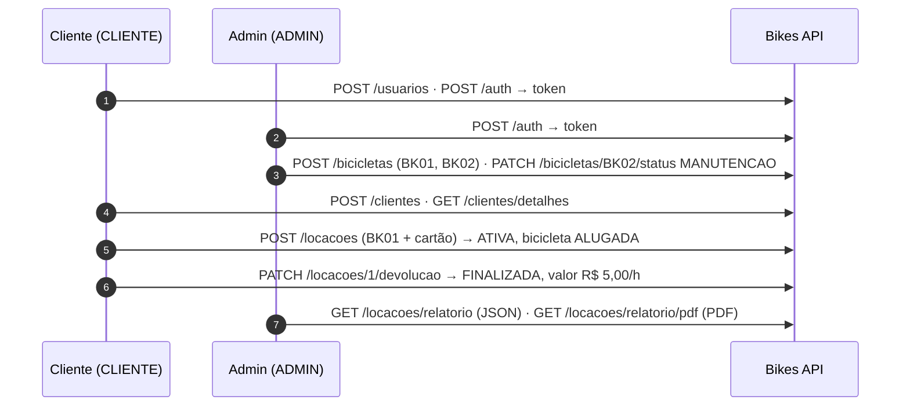

### O mesmo fluxo via `curl`

```bash
BASE=http://localhost:8080/api/v1
TOKEN_CLIENTE=$(curl -s -X POST $BASE/auth -H "Content-Type: application/json" \
  -d '{"username":"ana@bikes.com","password":"123456"}' | sed 's/.*"token":"\([^"]*\)".*/\1/')
TOKEN_ADMIN=$(curl -s -X POST $BASE/auth -H "Content-Type: application/json" \
  -d '{"username":"admin@bikes.com","password":"123456"}' | sed 's/.*"token":"\([^"]*\)".*/\1/')

# admin cadastra uma bicicleta
curl -X POST $BASE/bicicletas -H "Authorization: Bearer $TOKEN_ADMIN" -H "Content-Type: application/json" \
  -d '{"codigo":"BK01","modelo":"Caloi Elite Carbon","status":"DISPONIVEL"}'

# cliente se cadastra e solicita a locação (só os 4 últimos dígitos do cartão são persistidos)
curl -X POST $BASE/clientes -H "Authorization: Bearer $TOKEN_CLIENTE" -H "Content-Type: application/json" \
  -d '{"nome":"Ana Silva","cpf":"12345678901"}'
curl -X POST $BASE/locacoes -H "Authorization: Bearer $TOKEN_CLIENTE" -H "Content-Type: application/json" \
  -d '{"codigoBicicleta":"BK01","dataPrevistaDevolucao":"2027-01-10T18:00:00",
       "cartao":{"numero":"4111111111111111","titular":"ANA SILVA","validade":"12/30","cvv":"123"}}'

# devolução com problema → bicicleta em manutenção
curl -X PATCH $BASE/locacoes/1/devolucao -H "Authorization: Bearer $TOKEN_CLIENTE" -H "Content-Type: application/json" \
  -d '{"problema":true,"descricaoProblema":"Pneu traseiro furado"}'

# relatórios (admin): JSON e PDF
curl $BASE/locacoes/relatorio -H "Authorization: Bearer $TOKEN_ADMIN"
curl -o locacoes.pdf $BASE/locacoes/relatorio/pdf -H "Authorization: Bearer $TOKEN_ADMIN"
curl -o clientes.pdf $BASE/clientes/relatorio -H "Authorization: Bearer $TOKEN_ADMIN"
```

### Relatórios em PDF (JasperReports)

Os relatórios são gerados com **JasperReports 7** (`jasperreports`, `jasperreports-pdf`, `jasperreports-jdt` para compilar os `.jrxml` em tempo de execução e `jasperreports-fonts` para a fonte DejaVu Sans embutida no PDF).

| Arquivo | Papel |
|---------|-------|
| [`reports/styles/bikes-styles.jrtx`](src/main/resources/reports/styles/bikes-styles.jrtx) | **Arquivo de estilização** compartilhado: fonte base, título, cabeçalho de colunas, linhas zebradas, destaque de status, totais e rodapé. Injetado nos relatórios pelo parâmetro `REPORT_STYLES` |
| [`reports/locacoes-bikes.jrxml`](src/main/resources/reports/locacoes-bikes.jrxml) | Relatório de locações e devoluções (paisagem) com totais de locações, tempo de utilização e valor faturado |
| [`reports/clientes-bikes.jrxml`](src/main/resources/reports/clientes-bikes.jrxml) | Relatório de clientes cadastrados (retrato), com CPF formatado |
| [`reports/images/bikes-logo.png`](src/main/resources/reports/images/bikes-logo.png) | Logotipo exibido no cabeçalho (parâmetro `IMG_LOGO`) |
| [`JasperService`](src/main/java/br/edu/ifc/bikes/service/JasperService.java) | Carrega o template de estilos e o logo, compila e cacheia os `.jrxml`, converte os DTOs (`record`) em fonte de dados e exporta o PDF. Falhas viram `RelatorioException` (`500`) |

A imagem de runtime instala `fontconfig` e `ttf-dejavu`, necessários para o AWT medir textos na JRE Alpine.

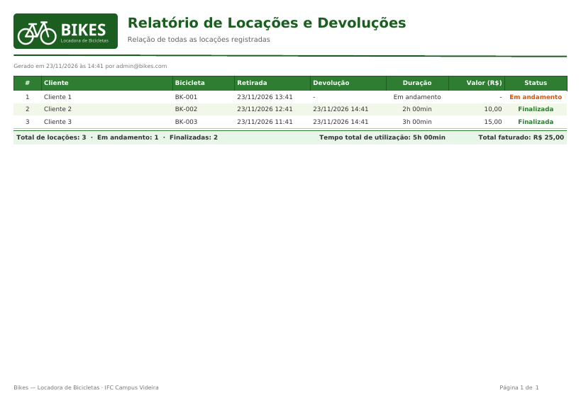

---

## 🐳 Dockerfile Multistage (requisito eliminatório)

[Dockerfile](Dockerfile):

| Estágio | Imagem base | Conteúdo |
|---------|-------------|----------|
| **1 — build** | `maven:3.9.16-eclipse-temurin-25-alpine` | JDK + Maven; resolve dependências (camada cacheada pelo `pom.xml`) e gera o `.jar` |
| **2 — runtime** | `eclipse-temurin:25-jre-alpine` | **Apenas JRE** + `app.jar` copiado do estágio 1 (`COPY --from=build`) |

Verificação na imagem final (`bikes-app`):

```text
$ docker run --rm --entrypoint sh bikes-app -c 'command -v javac; command -v mvn; ls /app; id'
javac: ausente
mvn: ausente
app.jar
uid=100(spring) gid=101(spring)
```

- Sem JDK, sem Maven, sem código-fonte e sem o repositório `~/.m2` na imagem de produção — só o JRE (~190 MB) e o JAR (~64 MB).
- Executa como usuário **não-root** (`spring`), com `TZ=America/Sao_Paulo` e `-XX:MaxRAMPercentage=75` (heap respeita o limite de memória do container).
- A própria esteira de CI **falha** se `javac` ou `mvn` aparecerem na imagem final (passo *Verificar runtime enxuto*).

---

## 🔁 Pipeline CI/CD (GitHub Actions)

[.github/workflows/ci-cd.yml](.github/workflows/ci-cd.yml) — disparada automaticamente em **push** e **pull request** para `main`/`master` (e manualmente via `workflow_dispatch`).

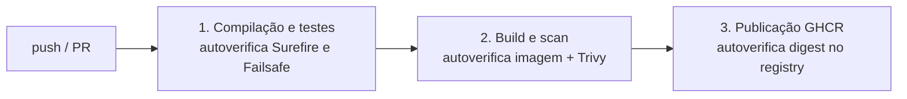

Cada segmento só fica verde depois de **confirmar o próprio resultado**. O job seguinte só começa se o anterior terminou com sucesso (`needs`).

| Segmento | O que faz | Autoverificação |
|----------|-----------|-----------------|
| **1. Compilação e testes** | Java 25 (Temurin), cache Maven, `./mvnw -B verify`. O Surefire roda os unitários (`*Test.java`, JUnit 5 + Mockito) e o Failsafe roda a integração (`*IT.java`) | Lê os relatórios do Surefire e do Failsafe e **falha** se uma das suítes não tiver testes, se o resumo for ilegível ou se `Failures`/`Errors` > 0 |
| **2. Build e scan** | `docker/build-push-action` (Dockerfile multistage, cache `type=gha`). A imagem é construída **uma única vez**, verificada (`bikes:ci` sem `javac`/`mvn`) e escaneada com **Trivy** | Confirma que `bikes:ci` existe, roda como `spring`, o entrypoint é `java` e o relatório `trivy-report.txt` foi gerado. Em seguida exporta **essa** imagem |
| **3. Publicação no GHCR** | Carrega o artefato do segmento 2 (a imagem já escaneada) e faz push de `sha-<commit>`, `latest` (branch padrão) e `pr-<n>` (PRs internos) | Consulta a API do GHCR e **falha** se a tag não responder HTTP 200 ou se o `Docker-Content-Digest` for diferente do digest devolvido pelo push. PRs de forks não executam este segmento |

Práticas DevSecOps aplicadas na esteira:
- **Menor privilégio**: `permissions: contents: read` global; só o segmento de publicação recebe `packages: write`.
- **Actions fixadas por SHA de commit** (com a versão em comentário) — protege contra tags reescritas em ataques de supply chain.
- `concurrency` cancela execuções obsoletas da mesma branch/PR.
- Autenticação no GHCR com o `GITHUB_TOKEN` efêmero (nenhum segredo manual).
- O que é publicado é o artefato que passou no runtime check e no Trivy, não um segundo build.

> O GitLab tem as mesmas três etapas (testes, build, publicação) em [.gitlab-ci.yml](.gitlab-ci.yml). A autoverificação de cada segmento, inclusive o digest no registry, está na esteira do GitHub Actions.

### Evidências

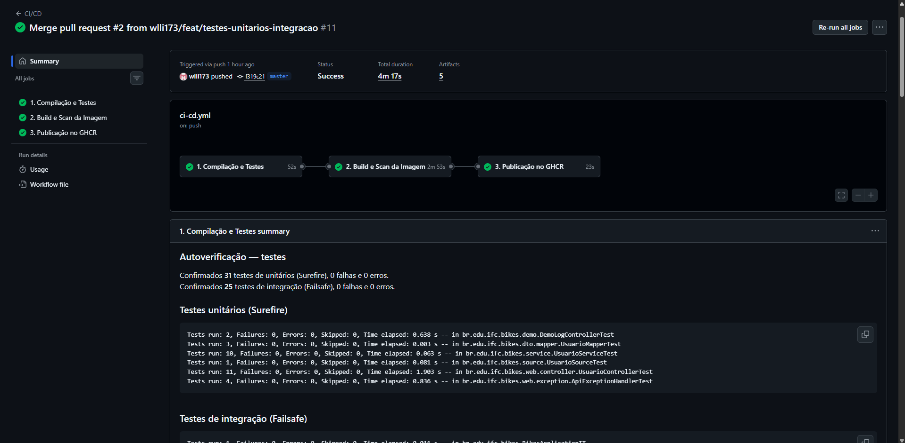

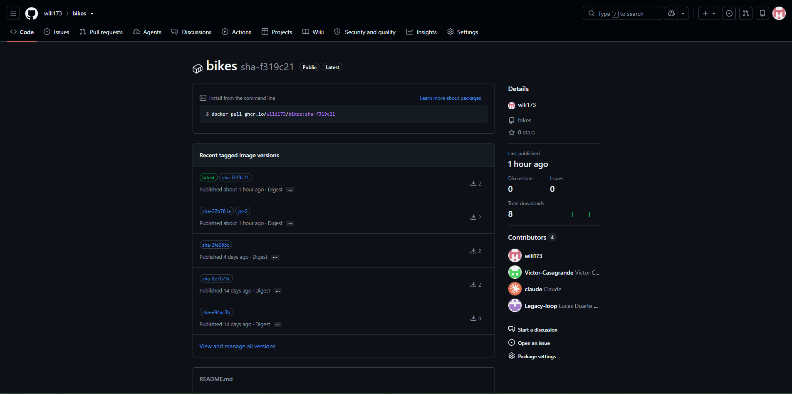

---

## 📈 Monitoramento — Prometheus

- A aplicação usa **Spring Boot Actuator + Micrometer** (`micrometer-registry-prometheus`) e expõe `/actuator/prometheus` ([application.properties](src/main/resources/application.properties)).
- Histograma de latência habilitado (`percentiles-histogram.http.server.requests=true`) para calcular p95 no Prometheus.
- [prometheus/prometheus.yml](prometheus/prometheus.yml) faz o scrape de `app:8080/actuator/prometheus` **a cada 5 s** (job `bikes-app`).

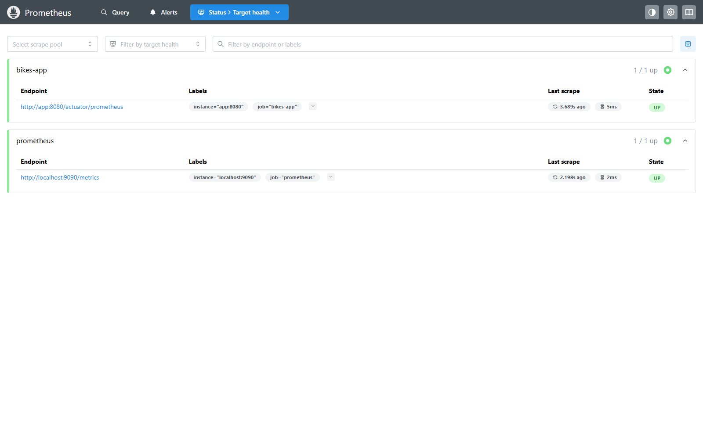

---

## 📊 Observabilidade — Grafana

Datasource e dashboard provisionados como código em [grafana/provisioning/](grafana/provisioning/) — nada é configurado manualmente. Dashboard **"Bikes — JVM & Spring Boot"** (21 painéis, atualização a cada 10 s):

| Seção | Painéis | Requisito do enunciado |
|-------|---------|------------------------|
| Visão geral | RPS total, taxa de erro 5xx, latência p95, uptime | — |
| JVM e sistema | **Memória Heap** (usado / committed / máximo), **Uso de CPU** (processo e container) | Heap da JVM · CPU |
| Tráfego HTTP | **RPS por classe de status (2xx/4xx/5xx)**, RPS por endpoint, **contagem por classe e por status code** | RPS · contagem por status |
| Tempo de resposta | **Tempo médio e p95 por classe de status**, p95 por endpoint | tempo de resposta por status |
| Runtime e logs | Threads, pausas de GC, eventos de log por nível (Logback) | — |

As consultas excluem `/actuator/*` para que o scrape do Prometheus e os healthchecks não poluam as métricas de negócio.

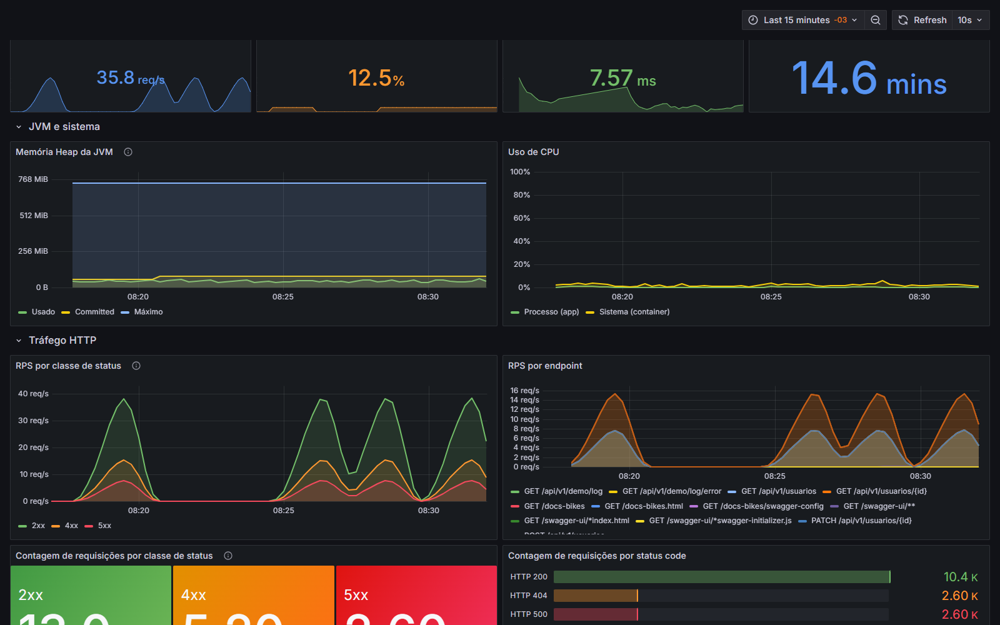
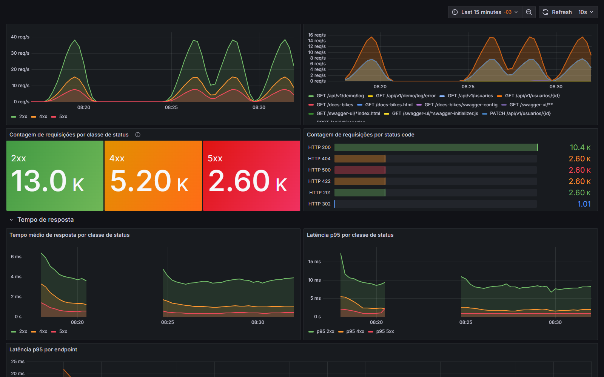
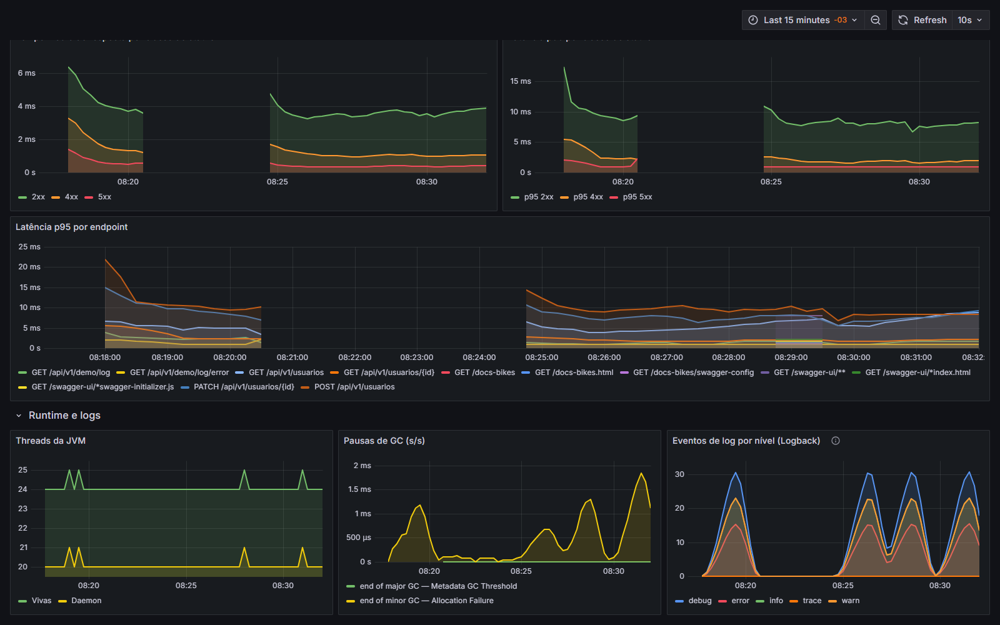
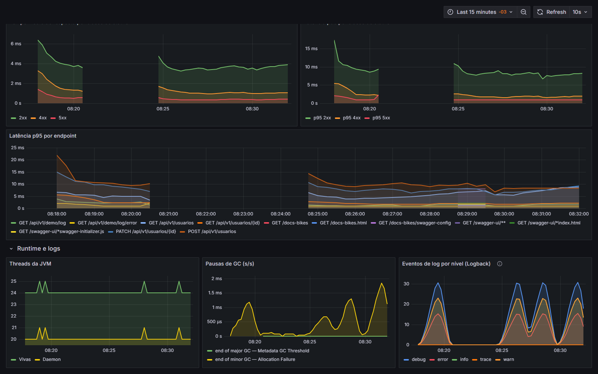

---

## 🪵 Logs centralizados — Graylog

- **Stack**: Graylog 6.1 + OpenSearch 2.15 + MongoDB 6.0.
- **Envio**: appender GELF UDP no Logback ([logback-spring.xml](src/main/resources/logback-spring.xml)) usando `de.siegmar:logback-gelf`, com os logs também no console.
- **Input automático**: o container `graylog-init` executa [graylog/init-gelf-input.sh](graylog/init-gelf-input.sh), que cria o input *GELF UDP* via API REST de forma **idempotente**; a app só sobe depois (`service_completed_successfully`), então nenhum log inicial se perde.
- **Mensagens estruturadas** — campos pesquisáveis em cada mensagem:

| Campo | Exemplo |
|-------|---------|
| `source` | `bikes-app` |
| `level_name` | `DEBUG`, `INFO`, `WARN`, `ERROR` |
| `logger_name` | `br.edu.ifc.bikes.service.UsuarioService` |
| `application` / `environment` | `bikes` / `docker` |
| `thread_name` | `http-nio-8080-exec-3` |
| `full_message` | mensagem completa, com stack trace quando houver exceção |

Consultas úteis no Graylog: `source:bikes-app AND level_name:ERROR` · `logger_name:br.edu.ifc.bikes.service.UsuarioService` · `message:"Requisição inválida"`

Além do endpoint de demonstração, a aplicação registra eventos reais de negócio: criação de usuário (INFO), buscas e listagens (DEBUG), usuário inexistente e requisições inválidas (WARN).

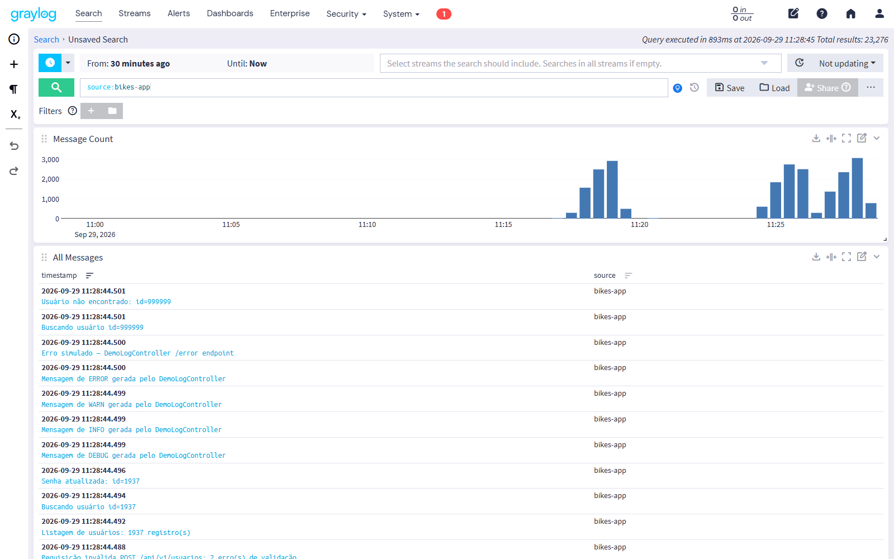
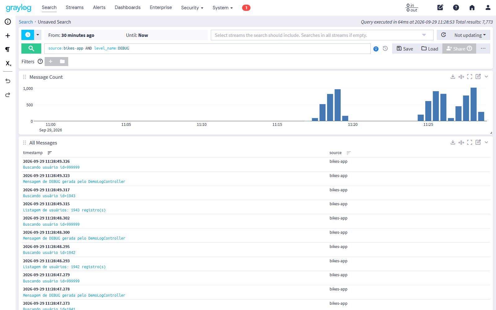
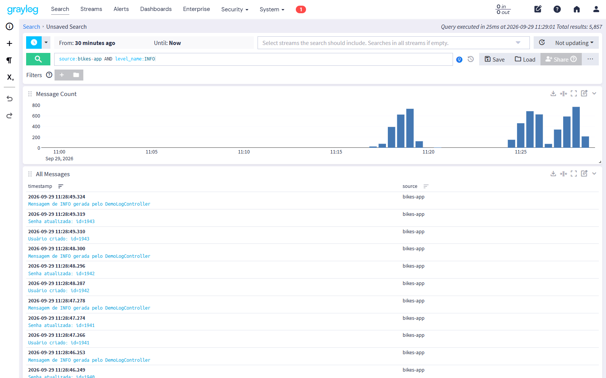
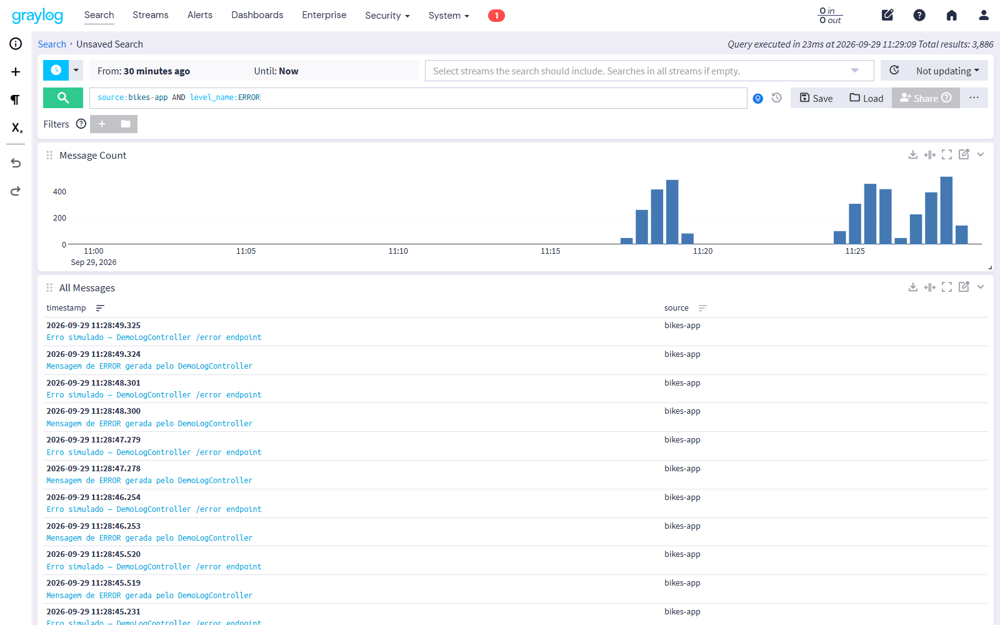
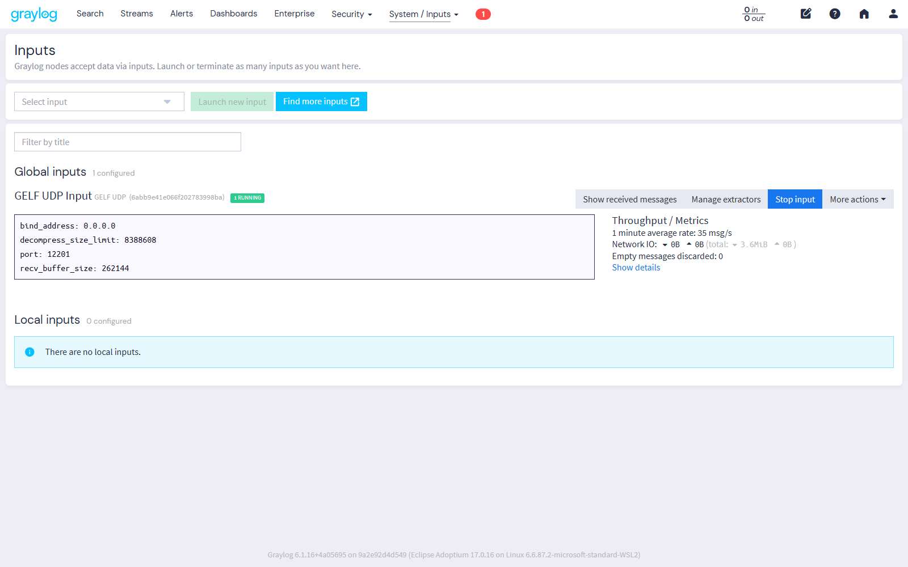

---

## 🔧 Decisões técnicas

1. **Healthchecks reais + `depends_on: condition`** — `depends_on` simples só espera o container iniciar. OpenSearch e Graylog levam de 60 a 120 s para aceitar conexões, então cada serviço tem um healthcheck de verdade (`mysqladmin ping`, `mongosh ping`, `/_cluster/health`, `/api/system/lbstatus`, `/actuator/health`, `/-/healthy`, `/api/health`) com `start_period` generoso. É isso que garante a subida "de primeira".
2. **Biblioteca GELF `de.siegmar:logback-gelf`** em vez de `logstash-gelf` ou do driver GELF do Docker: é compatível com o Logback 1.5.x do Spring Boot 4, não traz dependências extras e envia via UDP (não trava a app se o Graylog cair). O driver de log do Docker impediria o container de iniciar sem o Graylog pronto.
3. **Input GELF via init container**, não via content pack: o formato de content pack legado não é aceito pelo Graylog 6.x. O arquivo [graylog/contentpacks/gelf-udp-input.json](graylog/contentpacks/gelf-udp-input.json) fica só como referência.
4. **Limites de memória** para rodar em notebook de 8 GB: OpenSearch com heap de 512 MB (limite 1,5 GB), Graylog com 512 MB (limite 2 GB), MySQL com `innodb-buffer-pool-size=64M`, MongoDB com cache de 0,25 GB. Consumo total em repouso: ~2,5–3 GB.
5. **Portas internas**: MySQL, MongoDB e OpenSearch não são publicados no host. Isso reduz a superfície de ataque e evita conflito com serviços locais.
6. **Segurança da aplicação**:
   - console H2 desabilitado em runtime;
   - Actuator expõe apenas `health`, `info` e `prometheus`;
   - o e-mail do usuário (PII) **não** é gravado em log, só o id;
   - telemetria do Graylog desligada (`GRAYLOG_TELEMETRY_ENABLED=false`).
7. **Testes independentes da infraestrutura**: nos testes, H2 em memória substitui o MySQL e um `logback-test.xml` só com console substitui o GELF. Assim a esteira roda sem Docker e sem Graylog.
8. **`.env` versionado de propósito**: contém apenas valores do ambiente de avaliação (senha `admin` do Graylog, senha do MySQL local), necessários para o `docker compose up` funcionar sem nenhum passo manual. Em produção esses valores viriam de um cofre de segredos.
9. **Swagger com botão Authorize**: o `SpringDocOpenApiConfig` declara o esquema de segurança `bearer`/`JWT` e um `OperationCustomizer` adiciona o requisito de segurança **apenas** às operações anotadas com `@PreAuthorize`. Assim o Swagger UI permite executar os fluxos completos pelo navegador, e as rotas públicas (`POST /usuarios`, `POST /auth`) aparecem sem cadeado — sem repetir `@SecurityRequirement` em cada controller.
10. **Sincronização com o projeto base**: o código de domínio segue o repositório da disciplina (validação, `ApiExceptionHandler`, SpringDoc). As adições deste trabalho (Actuator, Micrometer, GELF, variáveis `DB_*`) ficam isoladas no `pom.xml` e no `application.properties`. A versão do `spring-boot-starter-validation` é gerenciada pelo parent, para evitar misturar uma versão milestone com o Boot 4.1.1.

---

## ✅ Testes automatizados

A esteira roda `./mvnw verify`, que executa as duas suítes:

| Suíte | Plugin | O que valida |
|-------|--------|--------------|
| **Unitários** (`*Test.java`) | Surefire | Serviços (`Usuario`, `Cliente`, `Bicicleta`, `Locacao`, `Jasper`), controllers (`@WebMvcTest` + Mockito, incluindo os endpoints PDF), `ApiExceptionHandler`, mappers MapStruct, `UsuarioSource` e `DemoLogController`, com repositório e serviço simulados |
| **Integração** (`*IT.java`) | Failsafe | Fluxo real com H2 e JWT: usuários, clientes (`/detalhes`, permissões por perfil), bicicletas (código único, troca de status), locações ponta a ponta (cadastro → locação → devolução com cálculo do valor → relatório JSON e PDF), geração real dos PDFs pelo `JasperService`, repositórios, documentação OpenAPI (`/docs-bikes` público, esquema Bearer JWT e cadeado só nas operações protegidas), logs de demonstração, health e Prometheus |

Rodar localmente sem instalar Java:

```bash
docker run --rm -v "$PWD":/ws -w /ws maven:3.9.16-eclipse-temurin-25-alpine mvn -B verify
```

---

## 📁 Estrutura do repositório

```
.
├── Dockerfile                          # multistage: build (JDK+Maven) → runtime (JRE)
├── docker-compose.yml                  # stack completa (app + observabilidade + bancos)
├── .env                                # variáveis do ambiente de avaliação
├── .github/workflows/ci-cd.yml         # esteira GitHub Actions
├── .gitlab-ci.yml                      # esteira equivalente (GitLab)
├── prometheus/prometheus.yml           # scrape da aplicação
├── grafana/provisioning/
│   ├── datasources/prometheus.yml      # datasource provisionado
│   └── dashboards/                     # provider + dashboard JSON
├── graylog/init-gelf-input.sh          # cria o input GELF via API (idempotente)
├── loadtest/script.js                  # carga k6 (perfil "loadtest")
├── docs/evidencias/                    # prints usados neste README
└── src/
    ├── main/java/br/edu/ifc/bikes/     # config, dto, entity, repository, service, web
    ├── main/resources/                 # application.properties, logback-spring.xml (GELF)
    │   └── reports/                    # JasperReports: styles/bikes-styles.jrtx, *.jrxml, images/
    └── test/                           # testes + H2 + logback-test.xml
```

---

## 🎯 Mapeamento da rubrica

| Critério | Pontos | Onde está |
|----------|--------|-----------|
| **0. Multistage Build** | Eliminatório | [Dockerfile](Dockerfile) · verificado também na esteira |
| **1. Pipeline CI/CD** | 2,5 | [ci-cd.yml](.github/workflows/ci-cd.yml) · testes → build → scan → push GHCR · [evidências](#evidências) |
| **2. Orquestração Docker Compose** | 2,0 | [docker-compose.yml](docker-compose.yml) · healthchecks + `depends_on` + init container |
| **3. Monitoramento de métricas** | 1,5 | Actuator/Micrometer no [pom.xml](pom.xml) · [prometheus.yml](prometheus/prometheus.yml) · print dos targets |
| **4. Observabilidade e Grafana** | 1,5 | [grafana/provisioning](grafana/provisioning/) · heap, CPU, RPS, contagem e tempo por status · prints |
| **5. Gestão de logs com Graylog** | 1,5 | [logback-spring.xml](src/main/resources/logback-spring.xml) · [init-gelf-input.sh](graylog/init-gelf-input.sh) · prints DEBUG/INFO/ERROR |
| **6. Documentação e README** | 1,0 | Este arquivo · [docs/evidencias/](docs/evidencias/) |

---

## 🔥 Troubleshooting

**OpenSearch falha com `max virtual memory areas vm.max_map_count [65530] is too low`** (Windows/WSL2):

```bash
wsl -d docker-desktop -u root -- sysctl -w vm.max_map_count=262144
```

Para persistir, adicione ao `%USERPROFILE%\.wslconfig` e rode `wsl --shutdown`:

```ini
[wsl2]
kernelCommandLine = "sysctl.vm.max_map_count=262144"
```

**Porta ocupada (8080, 9090, 3000, 9000)**: identifique o processo com `netstat -ano | findstr :8080` (Windows) ou `lsof -i :8080` (Linux/macOS), encerre-o ou altere a porta no `docker-compose.yml`.

**Containers com `OOMKilled`**: aumente a memória do Docker Desktop (Settings → Resources → Memory) para 6–8 GB.

**Dashboard sem dados**: gere tráfego com `docker compose --profile loadtest up loadtest` e confira se o target `bikes-app` está `UP` em http://localhost:9090/targets.

---

## 👥 Equipe

| Integrante | Responsabilidade |
|------------|------------------|
| Willighan | Pipeline CI/CD (GitHub Actions + GHCR) |
| Lucas | Prometheus + Grafana |
| Victor | Graylog, docker-compose e documentação |
